# SkyCampus-Infernape-ECI-Giral

## Repositorio Infernape: 

https://github.com/jcobos548/SkyCampus-Infernape-ECI-Giral.git

# Evidencia del Reto 1 — Infernape

## Captura de evidencia

# Evidencia del Reto 2 — Infernape

# Reto 3 — Nuevos problemas, nuevos patrones

## 1. Composite — rutas simples y compuestas
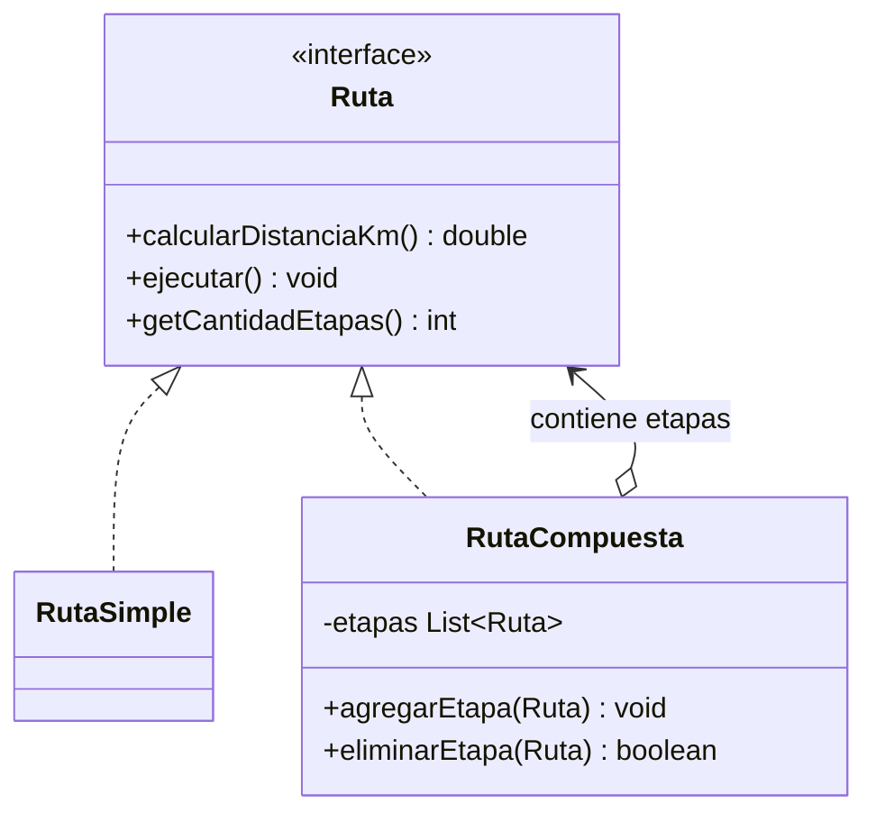
**Justificación:** permite tratar una ruta simple y una compuesta mediante la misma interfaz. Una solución con condicionales o clases para cada cantidad de etapas haría que el gestor tuviera que cambiar cuando cambie la estructura.

## 2. Strategy — optimización intercambiable
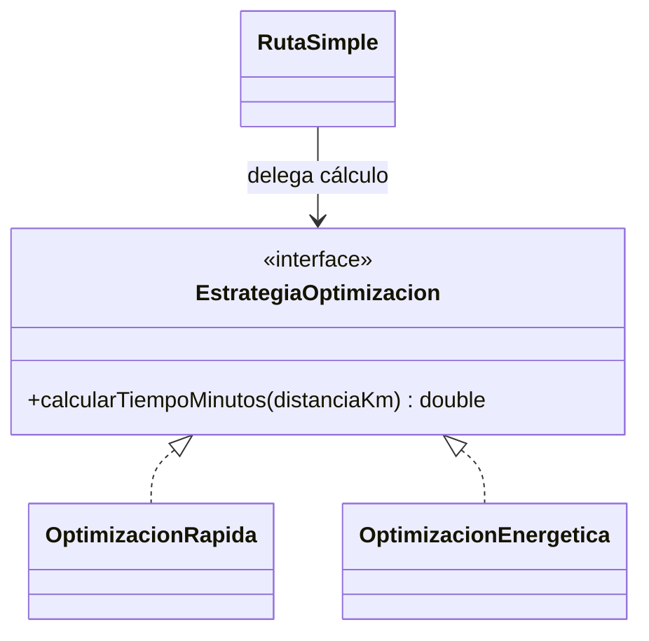
**Justificación:** cada algoritmo se encapsula detrás de una interfaz común. Es preferible a una cadena de `if/else` dentro de `RutaSimple`: se pueden agregar algoritmos sin modificar la clase existente, respetando el principio abierto/cerrado. En este ejemplo, rápida usa 60 km/h y energética 40 km/h.

## 3. Observer — alertas por etapa
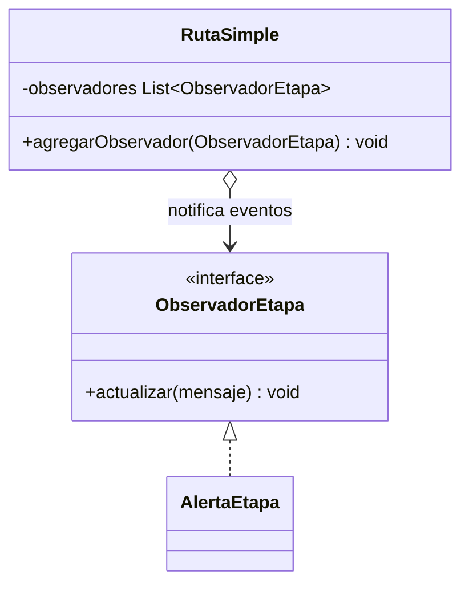
**Justificación:** separa la emisión de eventos de las acciones que reaccionan. Se pueden añadir receptores de consola, logs o monitoreo sin cambiar la ruta. Imprimir las alertas directamente en toda la lógica acoplaría el dominio a un único canal.

## 4. Factory Method — creación del tipo de dron
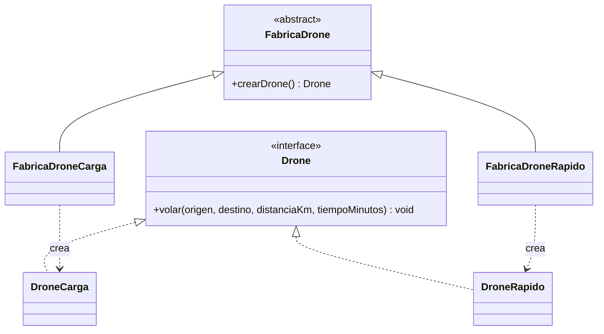
**Justificación:** la ruta solicita un `Drone` mediante una fábrica abstracta, sin instanciar directamente clases concretas. Nuevos tipos se agregan con nuevas fábricas, en vez de ampliar condicionales dentro de `RutaSimple`.

## Diagrama

# Reto 4 — Asignador de Misiones Enterprise

## Evidencia

# Reto 5 — Evolución de los diagramas de contexto de SkyCampus

## 1. Introducción

Los diagramas de contexto de SkyCampus muestran cómo ha evolucionado el sistema desde su versión inicial MVP (Chimchar), pasando por la versión v2 (Monferno), hasta llegar a Enterprise (Infernape). En cada etapa se amplían los actores, las integraciones y las responsabilidades, de acuerdo con las necesidades de una plataforma cada vez más completa.

## 2. Comparación de los tres diagramas

### Chimchar — MVP

En la primera versión, SkyCampus App tiene una estructura sencilla y se centra en gestionar solicitudes y misiones de entrega con drones en el campus.

Los actores que interactúan con el sistema son:

- **Solicitante:** registra las solicitudes de entrega.
- **Operador:** gestiona las operaciones.
- **Admin:** administra el sistema.

En esta etapa no aparecen sistemas externos. Esto permite concentrarse en las funcionalidades principales antes de incorporar nuevas integraciones.

### Monferno — v2

En la segunda versión, SkyCampus conserva su propósito principal, pero amplía sus relaciones con el entorno. Aparecen integraciones con la API Meteorológica, el Control Aéreo ECI y el Sistema de Alertas.

También se amplía la representación de los actores administrativos y operativos. El diagrama muestra al Operador, Solicitante y Admin, con una segunda representación de Admin, además de las conexiones con los sistemas externos.

Esta evolución permite contemplar información meteorológica, coordinación aérea y notificaciones, haciendo que el sistema dependa de más componentes externos que en el MVP.

### Infernape — Enterprise

En la versión Enterprise, SkyCampus incorpora nuevos roles y amplía sus integraciones institucionales.

A los actores anteriores se suman:

- **Superadmin:** representa la supervisión general de la plataforma.
- **Coordinador de sede:** representa la coordinación de las operaciones en una sede.
- **Técnico de Mantenimiento:** representa las actividades de mantenimiento de los drones.

En cuanto a los sistemas externos, el diagrama incluye Aerocivil, ERP Universitario, Control Aéreo ECI, API Meteorológica y Sistema de Alertas. Esto refleja un entorno más amplio, con necesidades de coordinación institucional, operación y mantenimiento.

## 3. ¿Qué creció?

El crecimiento se observa principalmente en tres aspectos:

1. **Actores y responsabilidades:** aparecen roles relacionados con la supervisión empresarial, la coordinación de sedes y el mantenimiento de los drones.
2. **Integraciones externas:** se pasa de no tener sistemas externos en el MVP a depender de servicios meteorológicos, control aéreo, alertas e integraciones institucionales en las versiones posteriores.
3. **Complejidad operativa:** SkyCampus debe coordinar más responsabilidades y relaciones, lo que exige una mejor organización de sus funcionalidades y de la comunicación con otros sistemas.

## 4. ¿Qué se mantuvo?

A pesar de los cambios, el propósito central de SkyCampus sigue siendo el mismo: gestionar solicitudes y misiones de entrega con drones en el campus.

También se mantienen los actores fundamentales de la primera versión: Solicitante, Operador y Admin. Estos siguen siendo importantes incluso cuando se agregan nuevas responsabilidades y sistemas externos.

La aplicación continúa representando el punto central de interacción entre los usuarios y las funcionalidades del sistema. Las nuevas capacidades amplían su alcance, pero no reemplazan su objetivo inicial.

## 5. ¿Cómo evolucionó la complejidad sin perder la coherencia?

La complejidad aumentó de manera progresiva. Chimchar comienza con una aplicación sencilla y sin integraciones externas. Monferno incorpora servicios que apoyan la operación, como la información meteorológica, el control aéreo y las alertas. Finalmente, Infernape amplía los perfiles de usuario y las integraciones institucionales.

La coherencia se conserva porque las nuevas capacidades siguen relacionadas con el objetivo original de SkyCampus. No se cambia el propósito del sistema; se agregan responsabilidades y colaboraciones que permiten responder a necesidades más amplias.

Esta evolución también demuestra la importancia de definir claramente las responsabilidades de cada actor y de cada sistema externo. A medida que aumenta la complejidad, resulta necesario organizar mejor las relaciones para facilitar el mantenimiento, la comprensión y la futura ampliación de la plataforma.

## 6. Conclusión

La comparación de los tres diagramas muestra que SkyCampus pasó de una solución básica centrada en las solicitudes de entrega a una plataforma con más roles y relaciones institucionales.

Lo que más creció fue el número de responsabilidades y de integraciones externas, mientras que se mantuvo el objetivo principal de gestionar las operaciones de reparto con drones. La evolución progresiva permitió ampliar el sistema sin perder su identidad ni su propósito.

# Reto 6 — Matriz de trazabilidad de SkyCampus Enterprise

## 1. Objetivo

Construir una matriz de trazabilidad que relacione los requisitos funcionales (RF) y no funcionales (RNF) de SkyCampus Enterprise con sus casos de uso (CU), historias de usuario (HU) registradas en Jira y pruebas de validación.

La trazabilidad permite verificar que cada requisito tenga una forma de implementación y validación, identificar inconsistencias y comprobar que las funcionalidades del sistema respeten las restricciones de seguridad.

## 2. Priorización MoSCoW

Se utiliza el método MoSCoW para clasificar la importancia de los requisitos:

- **Must have:** requisito indispensable para la entrega.
- **Should have:** requisito importante, pero no indispensable para el funcionamiento mínimo.
- **Could have:** funcionalidad conveniente que puede aplazarse.
- **Won't have:** funcionalidad excluida del alcance de esta entrega.

## 3. Historias de usuario registradas en Jira

Las siguientes historias corresponden al backlog de Infernape (Enterprise):

| Clave Jira | Historia de usuario |
|---|---|
| SKC-14 | Configurar radio máximo de vuelo por sede |
| SKC-15 | Validar restricciones aéreas antes de autorizar vuelos |
| SKC-16 | Asignar drones automáticamente a las misiones |
| SKC-17 | Consultar condiciones meteorológicas |
| SKC-18 | Generar alertas automáticas por fallos |
| SKC-19 | Gestionar técnicos de mantenimiento |
| SKC-20 | Visualizar la flota agrupada por estado |
| SKC-21 | Gestionar usuarios y permisos por rol |

Estas claves son las identificadas en el tablero de Jira. Los requisitos, casos de uso y pruebas que aparecen a continuación constituyen la propuesta de trazabilidad para relacionarlas.

## 4. Matriz de trazabilidad de requisitos funcionales

| Código | Requisito funcional | MoSCoW | Caso de uso | Historia Jira | Prueba de validación |
|---|---|---|---|---|---|
| RF-01 | Asignar drones automáticamente a las misiones | Must | CU-01: Asignar drones | SKC-16 | PR-01: Verificar que se asigne un dron apto y disponible, y que se rechace la asignación si no existe uno adecuado. |
| RF-02 | Consultar condiciones meteorológicas | Must | CU-02: Consultar meteorología | SKC-17 | PR-02: Verificar que se consulten y presenten las condiciones meteorológicas disponibles. |
| RF-03 | Generar alertas automáticas por fallos | Must | CU-03: Gestionar alertas | SKC-18 | PR-03: Simular un fallo y verificar que se genere la alerta correspondiente. |
| RF-04 | Gestionar técnicos de mantenimiento | Should | CU-04: Gestionar mantenimiento | SKC-19 | PR-04: Verificar el registro y la consulta de técnicos de mantenimiento. |
| RF-05 | Visualizar la flota agrupada por estado | Should | CU-05: Consultar flota | SKC-20 | PR-05: Verificar que los drones se agrupen de acuerdo con su estado actual. |
| RF-06 | Gestionar usuarios y permisos por rol | Must | CU-06: Administrar permisos | SKC-21 | PR-06: Verificar que cada rol pueda ejecutar únicamente las operaciones autorizadas. |
| RF-07 | Validar las restricciones aéreas antes de autorizar vuelos | Must | CU-07: Validar ruta de vuelo | SKC-15 | PR-07: Verificar que se rechacen las rutas que incumplan las restricciones aéreas aplicables. |
| RF-12 | Configurar el radio máximo de vuelo por sede | Must | CU-08: Configurar radio de vuelo | SKC-14 | PR-08: Verificar que se guarde una configuración válida y que esta no permita autorizar vuelos que incumplan restricciones de seguridad. |

**Nota:** RF-01 a RF-07 representan la numeración propuesta para organizar las funcionalidades del backlog. RF-12 se conserva porque corresponde al requisito explícito del reto. Los identificadores CU y PR son referencias documentales propuestas, no claves de Jira ni pruebas cuya implementación ya esté confirmada.

## 5. Matriz de trazabilidad de requisitos no funcionales

| Código | Requisito no funcional | Prioridad | Caso de uso relacionado | Historia Jira relacionada | Prueba de validación |
|---|---|---|---|---|---|
| RNF-01 | Seguridad y control de acceso por roles | Must | CU-06: Administrar permisos | SKC-21 | PR-09: Verificar que un usuario sin autorización no pueda ejecutar operaciones restringidas. |
| RNF-02 | Rendimiento de consultas y operaciones | Should | CU-02: Consultar meteorología | SKC-17 | PR-10: Medir el tiempo de respuesta frente a un umbral definido por el equipo. |
| RNF-03 | Disponibilidad y manejo controlado de fallos | Should | CU-03: Gestionar alertas | SKC-18 | PR-11: Simular una falla de una dependencia y verificar que el sistema responda de forma controlada. |
| RNF-09 | Cumplimiento de las restricciones del espacio aéreo controlado y del límite urbano de 120 m | Must | CU-07: Validar ruta de vuelo | SKC-15 | PR-12: Verificar que se rechace una ruta que supere los 120 m en una zona urbana, incluso si el radio configurado lo permite. |

**Importante:** RNF-09 es el requisito de seguridad aérea indicado en el reto. RNF-01, RNF-02 y RNF-03 son propuestas para completar los cuatro RNF solicitados y deben contrastarse con el catálogo oficial del proyecto. Para RNF-02 y RNF-03 es necesario acordar métricas medibles antes de ejecutar las pruebas.

## 6. Contradicción entre RF-12 y RNF-09

### Descripción del conflicto

RF-12 permite que el coordinador de cada sede configure el radio máximo de vuelo de los drones. Por su parte, RNF-09 establece que las rutas entre sedes deben respetar las restricciones del espacio aéreo controlado por Aerocivil y que ningún dron puede volar por encima de 120 metros en una zona urbana, según la condición definida para este proyecto.

El conflicto aparece cuando el radio configurado permite una ruta que incumple una restricción aérea. Por ejemplo, un coordinador podría configurar un radio de 10 km, pero una ruta dentro de ese alcance podría atravesar una zona restringida o superar el límite de altura urbana.

### Resolución

La configuración realizada por el coordinador no puede anular las restricciones de seguridad aérea.

- El coordinador puede configurar el radio máximo de vuelo de su sede dentro de los límites operativos permitidos.
- Antes de autorizar una misión, el sistema debe validar la ruta frente a las restricciones aéreas aplicables.
- Una ruta que supere los 120 metros en una zona urbana debe ser rechazada conforme al requisito del proyecto.
- Una ruta que atraviese una zona restringida debe rechazarse o modificarse hasta cumplir las restricciones aplicables.
- Si no es posible verificar una restricción crítica, el sistema no debe autorizar automáticamente la misión.

### Regla de decisión

**Una misión solo puede continuar si respeta el radio configurado y las restricciones aéreas aplicables.**

De manera conceptual:

`Ruta autorizada = dentro del radio permitido Y cumple las restricciones aéreas`

La expresión representa una regla lógica de diseño. No sustituye la validación de la ruta completa, la altitud, las zonas restringidas ni las autorizaciones necesarias.

### Pruebas de aceptación

| Prueba | Escenario | Resultado esperado |
|---|---|---|
| PR-12A | El radio está configurado correctamente y la ruta cumple las restricciones. | La ruta puede continuar con las demás validaciones. |
| PR-12B | El radio permite una ruta que supera los 120 m en zona urbana. | El sistema rechaza la ruta. |
| PR-12C | La ruta atraviesa una zona restringida. | El sistema rechaza la ruta o exige una alternativa válida. |
| PR-12D | No se puede verificar una restricción aérea crítica. | El sistema no autoriza automáticamente la misión. |

## 7. Otras contradicciones y riesgos

### 7.1. Asignación automática y mantenimiento

**Conflicto:** el sistema podría intentar asignar una misión a un dron que está en mantenimiento o fuera de servicio.

**Resolución:** la asignación automática debe comprobar la disponibilidad del dron y excluir aquellos que no estén habilitados para operar.

**Validación:** PR-01 debe comprobar que no se asignen drones no disponibles. PR-04 debe verificar la gestión de mantenimiento.

### 7.2. Alertas y fallos de servicios externos

**Conflicto:** la indisponibilidad de una dependencia puede impedir la consulta meteorológica o el envío de una alerta.

**Resolución:** el sistema debe gestionar los errores de manera controlada, evitar operaciones incorrectas y comunicar la imposibilidad de completar una acción cuando corresponda.

**Validación:** PR-11 debe comprobar el comportamiento frente a fallos de dependencias. Las pruebas de alertas deben verificar que los fallos detectados generen las notificaciones previstas.

### 7.3. Permisos y administración por sede

**Conflicto:** un coordinador podría intentar modificar la configuración de una sede distinta de la que tiene asignada o ejecutar funciones exclusivas de otro rol.

**Resolución:** los permisos deben validarse tanto por rol como por ámbito de sede.

**Validación:** PR-06 y PR-09 deben comprobar que se rechacen las operaciones no autorizadas.

## 8. Criterios de completitud de la matriz

La matriz se considera completa cuando:

1. Los ocho requisitos funcionales tienen código, nombre, prioridad MoSCoW, caso de uso, historia de usuario y prueba asociada.
2. Los cuatro requisitos no funcionales tienen un método de verificación definido.
3. Cada historia de usuario está vinculada a su requisito correspondiente mediante una clave real de Jira.
4. Los casos de uso están documentados y corresponden al comportamiento esperado del sistema.
5. Las pruebas referenciadas están implementadas o cuentan con un plan de prueba aprobado.
6. Las contradicciones detectadas tienen reglas de resolución y pruebas de aceptación.
7. Existe evidencia verificable de la ejecución de las pruebas.

Las referencias PR-01 a PR-12 son identificadores documentales propuestos. Deben asociarse con las pruebas reales del proyecto y no deben presentarse como pruebas ejecutadas si aún no se han realizado.

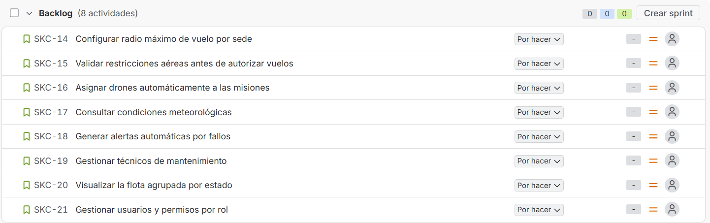

# Reto 7 — Plantilla DOSW para el RF «SC-15 Planificar ruta multi-etapa inter-sede»

## 1. Identificación del requisito

**Código:** SC-15

**Nombre:** Planificar ruta multi-etapa inter-sede.

**Actor principal:** Operador de drones.

**Actores secundarios:** Coordinador de sede, servicio de validación de Aerocivil, sistema de estaciones de carga.

**Descripción:** El sistema debe planificar una misión de transporte entre dos sedes, considerando las características del paquete, las condiciones actuales del espacio aéreo, las restricciones de Aerocivil, las estaciones de carga disponibles y la autonomía de los drones. La ruta debe dividirse en etapas que permitan transportar el paquete de forma segura hasta su destino.

## 2. Precondiciones

1. El operador debe estar autenticado y autorizado para planificar misiones.
2. Deben existir una sede de origen y una sede de destino válidas.
3. Debe existir información de la misión y del paquete que se transportará.
4. Debe estar disponible la información necesaria para verificar las restricciones del espacio aéreo.
5. Debe existir información actualizada sobre los drones y las estaciones de carga disponibles para evaluar la planificación.

## 3. Datos de entrada

Cada atributo de los subobjetos debe especificarse con un tipo de dato real.

| Nombre | Tipo de campo | Reglas | Obligatorio |
|---|---|---|---|
| misión | — | Contiene los datos necesarios para planificar el recorrido | Sí |
| misión.id | String | Identificador único de la misión | Sí |
| misión.paquete | — | Información del paquete transportado | Sí |
| misión.paquete.id | String | Identificador único del paquete | Sí |
| misión.paquete.pesoGramos | Integer | Debe ser mayor que cero | Sí |
| misión.paquete.tipo | Enum(SOBRE,CARPETA,LIBRO,EQUIPO) | Tipo de paquete permitido | Sí |
| misión.paquete.prioridad | Enum(URGENTE,NORMAL,BAJA) | Prioridad de transporte | Sí |
| misión.sedeOrigen | — | Sede desde la que inicia la misión | Sí |
| misión.sedeOrigen.id | String | Identificador de la sede | Sí |
| misión.sedeOrigen.nombre | String | Nombre de la sede | Sí |
| misión.sedeOrigen.latitud | Decimal | Coordenada geográfica | Sí |
| misión.sedeOrigen.longitud | Decimal | Coordenada geográfica | Sí |
| misión.sedeDestino | — | Sede a la que debe llegar el paquete | Sí |
| misión.sedeDestino.id | String | Identificador de la sede | Sí |
| misión.sedeDestino.nombre | String | Nombre de la sede | Sí |
| misión.sedeDestino.latitud | Decimal | Coordenada geográfica | Sí |
| misión.sedeDestino.longitud | Decimal | Coordenada geográfica | Sí |
| misión.restriccionesEspeciales | — | Condiciones adicionales de la misión | Sí |
| misión.restriccionesEspeciales.alturaMaximaMetros | Decimal | No puede superar los límites aplicables | No |
| misión.restriccionesEspeciales.zonasProhibidas | List<ZonaRestringida(id:String, latitud:Decimal, longitud:Decimal, radioMetros:Decimal)> | Zonas que deben evitarse | No |
| misión.restriccionesEspeciales.horaLimiteEntrega | LocalDateTime | Fecha y hora límite de entrega, si aplica | No |
| condicionesAereas | — | Estado actual del espacio aéreo | Sí |
| condicionesAereas.consultadoEn | LocalDateTime | Momento de la consulta | Sí |
| condicionesAereas.estado | Enum(VALIDO,RESTRINGIDO,NO_DISPONIBLE) | Resultado de la consulta | Sí |
| condicionesAereas.restricciones | List<RestriccionAerea(id:String, tipo:String, descripcion:String)> | Restricciones informadas por la fuente autorizada | Sí |

## 4. Datos de salida

| Nombre | Tipo de campo | Reglas | Obligatorio |
|---|---|---|---|
| planRuta | — | Resultado de la planificación | Sí |
| planRuta.id | String | Identificador del plan | Sí |
| planRuta.estado | Enum(PLANIFICADA,RECHAZADA,PENDIENTE_VALIDACION) | Estado de la planificación | Sí |
| planRuta.etapas | List<EtapaRuta(numero:Integer, origen:String, destino:String, distanciaKm:Decimal, requiereRecarga:Boolean)> | Etapas ordenadas del recorrido | Sí, si la ruta es válida |
| planRuta.estacionesCarga | List<EstacionAsignada(id:String, nombre:String, etapa:Integer, tiempoEstimadoMinutos:Integer)> | Estaciones asignadas a las etapas que necesitan recarga | Sí, si se requieren recargas |
| planRuta.asignaciones | List<AsignacionDrone(etapa:Integer, droneId:String, bateriaInicialPorcentaje:Integer, bateriaEstimadaFinalPorcentaje:Integer)> | Drone asignado a cada etapa | Sí, si la ruta es válida |
| planRuta.distanciaTotalKm | Decimal | Distancia total planificada | Sí, si la ruta es válida |
| planRuta.tiempoEstimadoMinutos | Integer | Tiempo estimado de recorrido y recargas | Sí, si la ruta es válida |
| planRuta.motivoRechazo | String | Explicación del rechazo, cuando corresponda | No |
| planRuta.confirmada | Boolean | Indica si el operador confirmó el plan | Sí |
| planRuta.vueloIniciado | Boolean | Indica si se inició el vuelo | Sí |

## 5. Flujo básico

1. El operador solicita planificar una misión y proporciona los datos del paquete, la sede de origen, la sede de destino y las restricciones especiales.
2. El sistema valida los datos de entrada y consulta las condiciones actuales del espacio aéreo y las restricciones aplicables de Aerocivil.
3. Si la validación es satisfactoria, el sistema calcula una ruta segura y la divide en etapas, garantizando que ningún tramo con carga supere los 5 km sin recarga.
4. El sistema identifica las estaciones de carga disponibles, las asigna cuando sean necesarias y verifica que el paquete no permanezca más de 30 minutos en ninguna estación.
5. El sistema asigna un drone apto a cada etapa, verifica la batería estimada y la capacidad de transporte, y presenta la ruta completa al operador.
6. El operador revisa y confirma el plan de ruta.
7. El sistema registra la confirmación y permite iniciar el vuelo cuando las validaciones y condiciones operativas sigan siendo satisfactorias.

## 6. Flujos alternativos

### FA-01. Aerocivil rechaza la ruta

1. Durante la validación, se identifica que la ruta incumple una restricción aérea aplicable.
2. El sistema rechaza la ruta propuesta y explica el motivo.
3. Si existe una alternativa segura y válida, el sistema puede recalcular la ruta.
4. Si no existe una alternativa válida, la planificación queda rechazada y no se permite iniciar el vuelo.

**Resultado:** no se autoriza una ruta que incumpla las restricciones aéreas.

### FA-02. No hay estaciones de carga disponibles

1. El sistema determina que se necesita una recarga durante el recorrido.
2. No encuentra una estación de carga disponible en una ubicación que permita continuar de forma segura.
3. El sistema intenta identificar una alternativa válida.
4. Si no existe una alternativa, rechaza la planificación e informa que no hay estaciones de carga adecuadas.

**Resultado:** no se confirma una ruta que dependa de una recarga no disponible.

### FA-03. El paquete es demasiado pesado para una ruta larga

1. El sistema evalúa el peso del paquete y la capacidad de los drones disponibles para cada etapa.
2. Detecta que el peso supera la capacidad permitida de los drones que podrían realizar un tramo.
3. El sistema busca una alternativa compatible, como otro drone apto o una ruta con etapas diferentes, si resulta viable.
4. Si no existe una solución válida, rechaza la planificación e informa que el paquete no puede transportarse con los recursos disponibles.

**Resultado:** no se asigna un drone cuya capacidad sea insuficiente.

### FA-04. Batería insuficiente

1. El sistema calcula la autonomía disponible para cada etapa considerando la carga transportada.
2. Detecta que un drone no tiene batería suficiente para completar su tramo de manera segura.
3. El sistema intenta asignar otro drone apto o incorporar una estación de carga válida.
4. Si no existe una alternativa, rechaza la planificación.

**Resultado:** ningún drone recibe una asignación que exceda su autonomía operativa.

### FA-05. El paquete supera el tiempo máximo en una estación

1. El sistema calcula el tiempo estimado de llegada, espera y recarga en cada estación.
2. Detecta que el paquete podría permanecer más de 30 minutos en una estación.
3. El sistema intenta modificar la asignación o la planificación para respetar el límite.
4. Si no es posible, rechaza la planificación.

**Resultado:** la ruta confirmada no puede contemplar una permanencia superior a 30 minutos en una estación.

### FA-06. La información del espacio aéreo no está disponible

1. El sistema intenta consultar las restricciones aéreas.
2. No puede obtener información suficiente y confiable.
3. El sistema deja la planificación en estado pendiente de validación o la rechaza.
4. No permite iniciar el vuelo mientras falte una validación crítica.

**Resultado:** la ausencia de información no se interpreta como autorización para volar.

## 7. Reglas de negocio

**RN-01. Distancia máxima por etapa:** un drone no puede recorrer más de 5 km con carga sin realizar una recarga. La planificación debe dividir el trayecto en etapas que respeten este límite.

**RN-02. Tiempo máximo en estación:** el paquete no puede permanecer más de 30 minutos en una estación de carga. El sistema debe considerar el tiempo estimado de espera y las operaciones de recarga.

**RN-03. Restricciones aéreas:** toda ruta debe cumplir las restricciones aplicables de Aerocivil y las condiciones vigentes del espacio aéreo. Una ruta rechazada no puede confirmarse ni iniciarse.

**RN-04. Capacidad del drone:** el peso del paquete no puede superar la capacidad máxima del drone asignado a ninguna etapa.

**RN-05. Autonomía:** cada drone debe disponer de batería suficiente para completar su etapa de acuerdo con la autonomía operativa definida para el sistema.

**RN-06. Disponibilidad de estaciones:** una estación solo puede asignarse si está disponible y puede atender la recarga dentro del tiempo máximo permitido.

**RN-07. Asignación por etapa:** cada etapa debe tener un drone compatible, disponible y con batería suficiente. Un drone asignado a una etapa no se considera automáticamente disponible para otra etapa simultánea.

**RN-08. Confirmación de ruta:** el vuelo solo puede iniciarse después de que el plan esté validado y confirmado. Si cambian las condiciones críticas, se debe realizar una nueva validación antes de continuar.

## 8. Criterios de aceptación

1. Dada una misión válida, el sistema calcula una ruta dividida en etapas y presenta su distancia total.
2. Ningún tramo con carga supera los 5 km sin recarga.
3. Cada estación asignada está disponible y respeta el límite de 30 minutos de permanencia del paquete.
4. Cada etapa tiene asignado un drone con capacidad y autonomía suficientes.
5. Una ruta que incumple las restricciones aéreas se rechaza.
6. Si no hay estaciones de carga adecuadas, el sistema no confirma una ruta inviable.
7. Si el paquete supera la capacidad de los drones disponibles, la misión se rechaza o se propone una alternativa válida.
8. El sistema no inicia el vuelo antes de validar y confirmar la ruta.
9. Cuando una validación crítica no puede realizarse, el sistema no autoriza automáticamente la misión.

## 9. Resultado esperado

El resultado del requisito SC-15 es un plan de ruta multi-etapa que incluye las etapas ordenadas, las estaciones de carga asignadas, el drone correspondiente a cada etapa, la autonomía estimada y el tiempo total de recorrido. La misión solo puede confirmarse e iniciarse cuando todas las restricciones de seguridad, capacidad, batería y permanencia en estaciones se cumplen.

# Reto 8 — Design Tokens de SkyCampus Enterprise

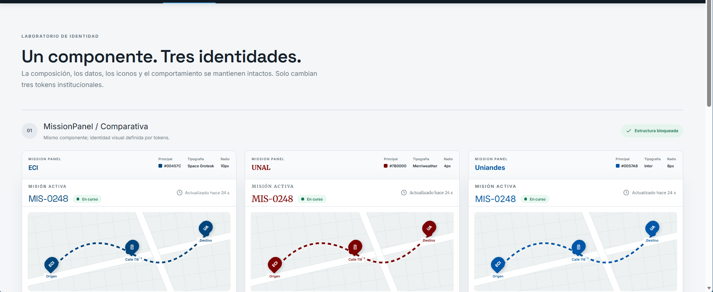

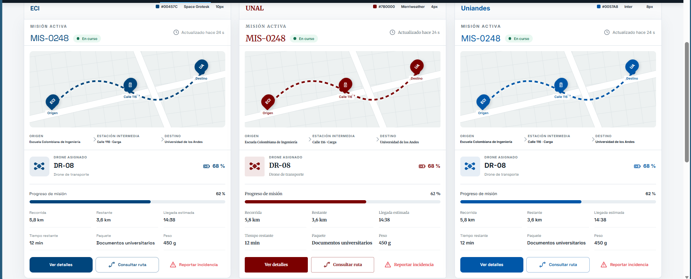

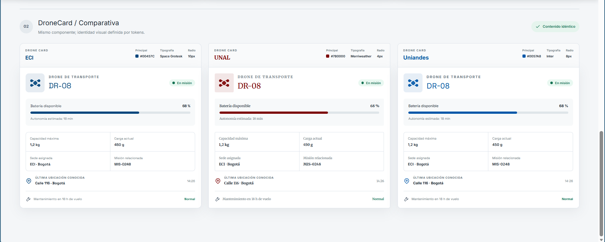

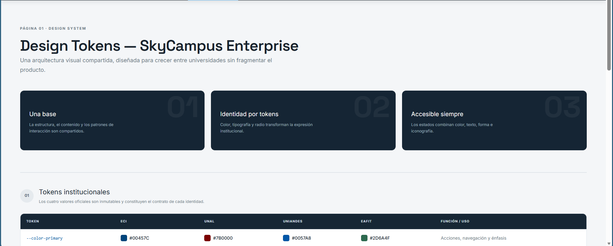

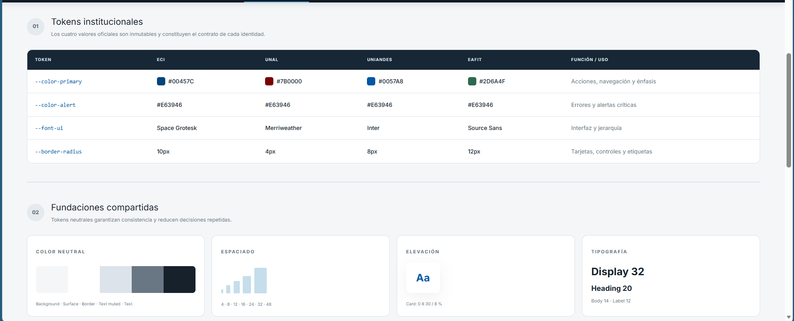

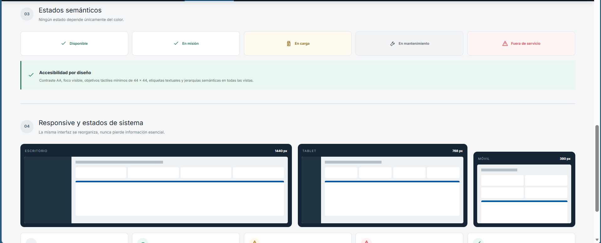

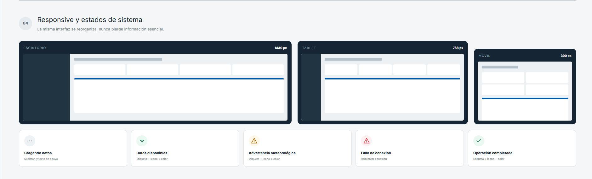

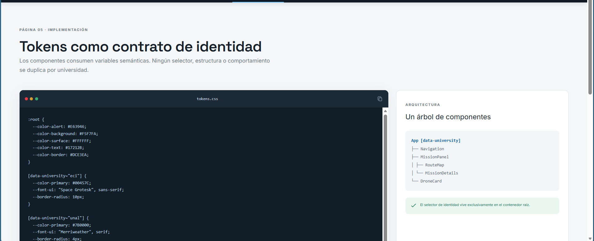

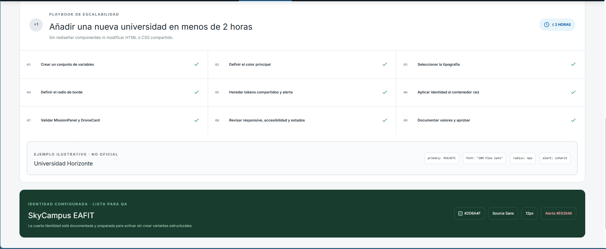

# Reto 9: Roadmap trimestral y ceremonias ágiles

## 1. Objetivo

Planificar el desarrollo de SkyCampus Enterprise durante tres sprints de dos semanas, organizando las historias de usuario, estimando los Story Points y definiendo los objetivos de cada sprint. Adicionalmente, se realiza una retrospectiva simulada del Sprint 1 para identificar fortalezas, oportunidades de mejora y compromisos concretos.

## 2. Roadmap en Jira

Se crearon tres sprints en Jira para organizar el desarrollo incremental de SkyCampus Enterprise.

| Sprint | Objetivo | Story Points estimados |
|---|---|---:|
| Sprint 1 | Conectividad multi-sede básica | 23 SP |
| Sprint 2 | Rutas multi-etapa y estaciones de carga | 26 SP |
| Sprint 3 | Analytics y panel superadmin | 24 SP |
| **Total** | **Roadmap de Enterprise** | **73 SP** |

Los Story Points corresponden a estimaciones iniciales de esfuerzo y complejidad. La velocity real se registrará al finalizar cada sprint.

## 3. Evidencias de Jira

### 3.1. Creación de los tres sprints

La siguiente evidencia muestra la organización del backlog en los tres sprints definidos para el trimestre.

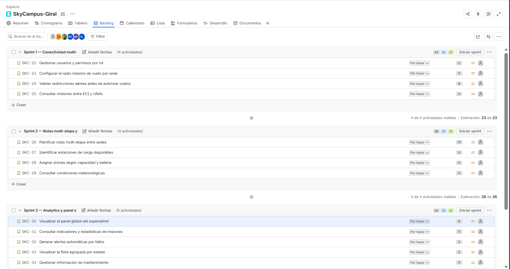

### 3.2. Sprint 1: Conectividad multi-sede básica

Este sprint contempla las historias relacionadas con la gestión de usuarios y permisos, la configuración del radio de vuelo por sede, la validación de restricciones aéreas y la consulta de misiones entre ECI y UNAL.

### 3.3. Sprint 2: Rutas multi-etapa y estaciones de carga

Este sprint contempla la planificación de rutas entre sedes, la identificación de estaciones de carga, la asignación de drones según su capacidad y batería, y la consulta de condiciones meteorológicas.

### 3.4. Sprint 3: Analytics y panel superadmin

Este sprint contempla el panel global de administración, los indicadores de las misiones, las alertas automáticas, la visualización de la flota y la gestión de información de mantenimiento.

### 3.5. Estimación de historias de usuario

En Jira se registrarán los Story Points de cada historia de usuario para facilitar la planificación y el seguimiento del trabajo comprometido en cada sprint.

## 4. Retrospectiva simulada del Sprint 1

La retrospectiva se plantea como un ejercicio simulado para evaluar el proceso de trabajo y definir acciones de mejora.

### ¿Qué salió bien?

- Se organizaron las historias de usuario y se distribuyeron responsabilidades por módulo.
- Se definió que las restricciones aéreas prevalecen sobre la configuración del radio máximo de vuelo por sede.
- Se planteó validar progresivamente la conectividad entre ECI y UNAL.

### ¿Qué debemos mejorar?

- Documentar mejor las dependencias entre módulos.
- Ampliar las pruebas automatizadas de permisos, restricciones aéreas y conectividad.
- Registrar y hacer seguimiento oportuno a los impedimentos.

### Compromisos de mejora

| Compromiso | Responsable | Fecha límite |
|---|---|---|
| Documentar las dependencias entre módulos. | Líder técnico | 2 de noviembre de 2026 |
| Agregar pruebas automatizadas para restricciones, permisos y conectividad. | Responsable de pruebas | 4 de noviembre de 2026 |
| Registrar los impedimentos en Jira y asignar acciones de seguimiento. | Facilitador del equipo | 3 de noviembre de 2026 |

## Reto 10: Diagrama de casos de uso de SkyCampus Enterprise

El siguiente diagrama representa las funcionalidades principales de SkyCampus Enterprise, organizadas en cinco paquetes: Gestión de Misiones, Gestión de Flota, Rutas y Navegación, Mantenimiento y Administración. También muestra los actores del sistema y la relación entre sus permisos.

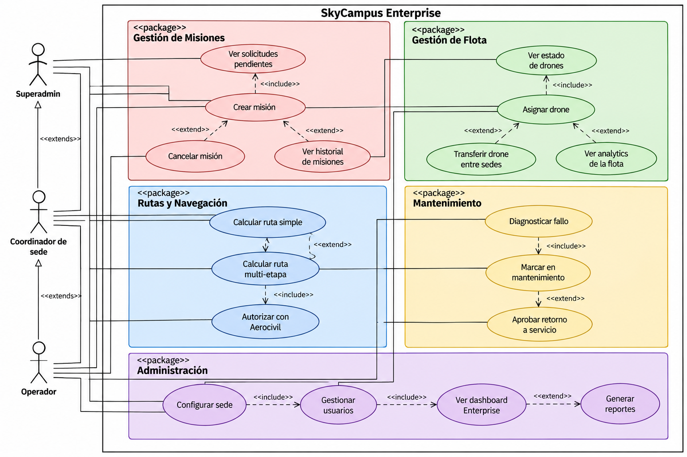
