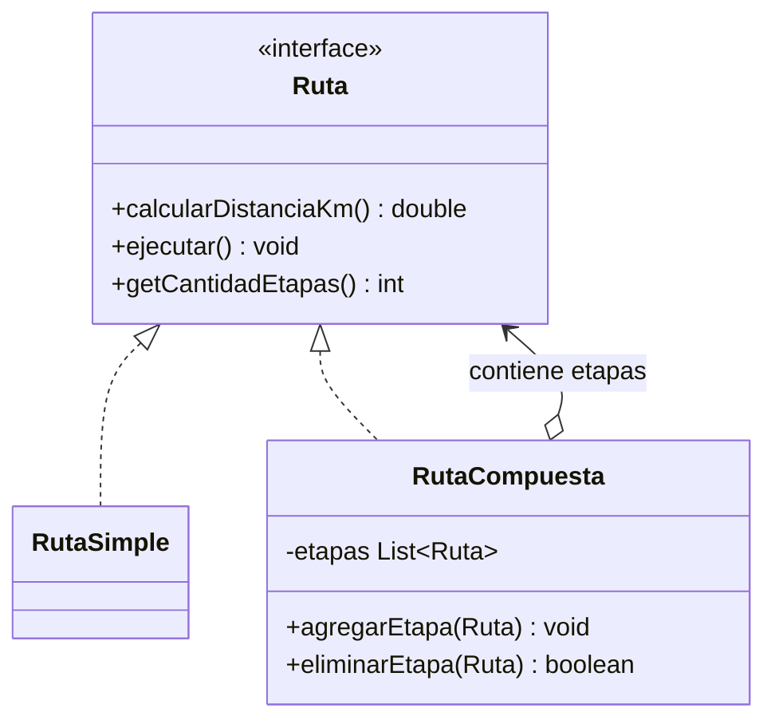
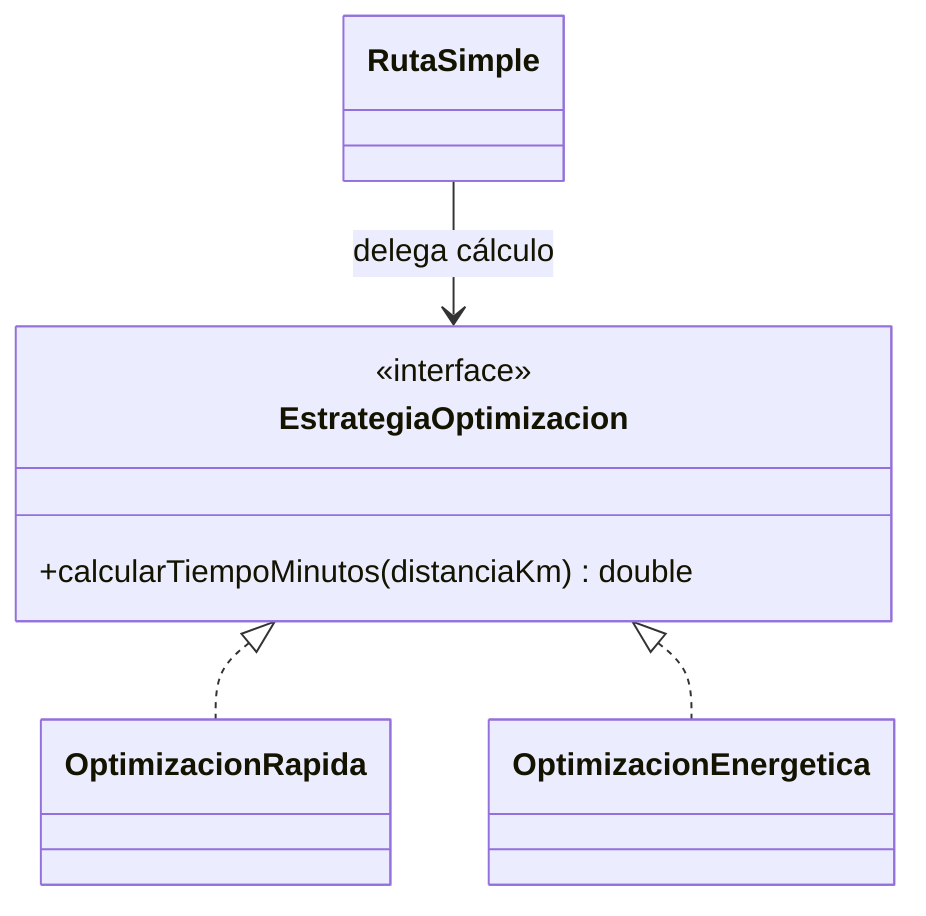
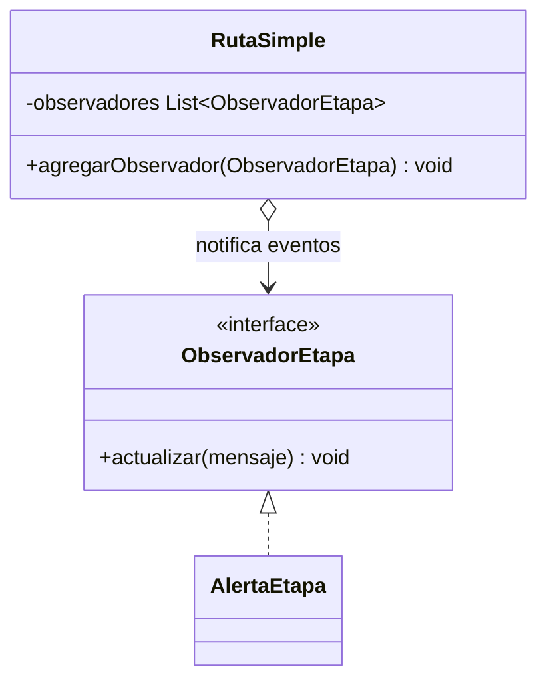
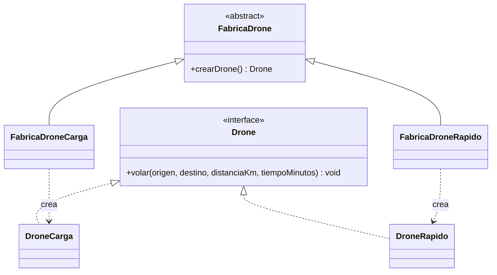

# SkyCampus-Infernape-ECI-Giral

https://github.com/jcobos548/SkyCampus-Infernape-ECI-Giral.git

# Evidencia del Reto 1 — Infernape

## Captura de evidencia

# Evidencia del Reto 2 — Infernape

# Reto 3 — Nuevos problemas, nuevos patrones

## 1. Composite — rutas simples y compuestas

**Justificación:** permite tratar una ruta simple y una compuesta mediante la misma interfaz. Una solución con condicionales o clases para cada cantidad de etapas haría que el gestor tuviera que cambiar cuando cambie la estructura.

## 2. Strategy — optimización intercambiable

**Justificación:** cada algoritmo se encapsula detrás de una interfaz común. Es preferible a una cadena de `if/else` dentro de `RutaSimple`: se pueden agregar algoritmos sin modificar la clase existente, respetando el principio abierto/cerrado. En este ejemplo, rápida usa 60 km/h y energética 40 km/h.

## 3. Observer — alertas por etapa

**Justificación:** separa la emisión de eventos de las acciones que reaccionan. Se pueden añadir receptores de consola, logs o monitoreo sin cambiar la ruta. Imprimir las alertas directamente en toda la lógica acoplaría el dominio a un único canal.

## 4. Factory Method — creación del tipo de dron

**Justificación:** la ruta solicita un `Drone` mediante una fábrica abstracta, sin instanciar directamente clases concretas. Nuevos tipos se agregan con nuevas fábricas, en vez de ampliar condicionales dentro de `RutaSimple`.

## Diagrama

# Reto 4 — Asignador de Misiones Enterprise

## Evidencia

