# SkyCampus-Infernape-ECI-Giral

https://github.com/jcobos548/SkyCampus-Infernape-ECI-Giral.git

# Evidencia del Reto 1 — Infernape

## Captura de evidencia

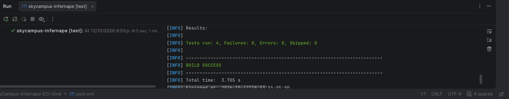

# Evidencia del Reto 2 — Infernape

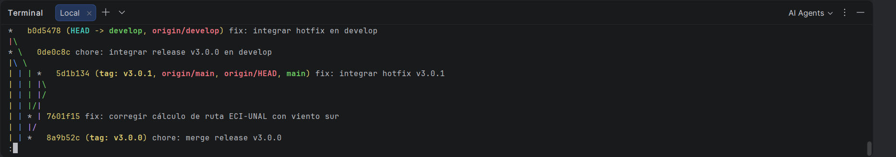

# Reto 3 — Nuevos problemas, nuevos patrones

## 1. Composite — rutas simples y compuestas
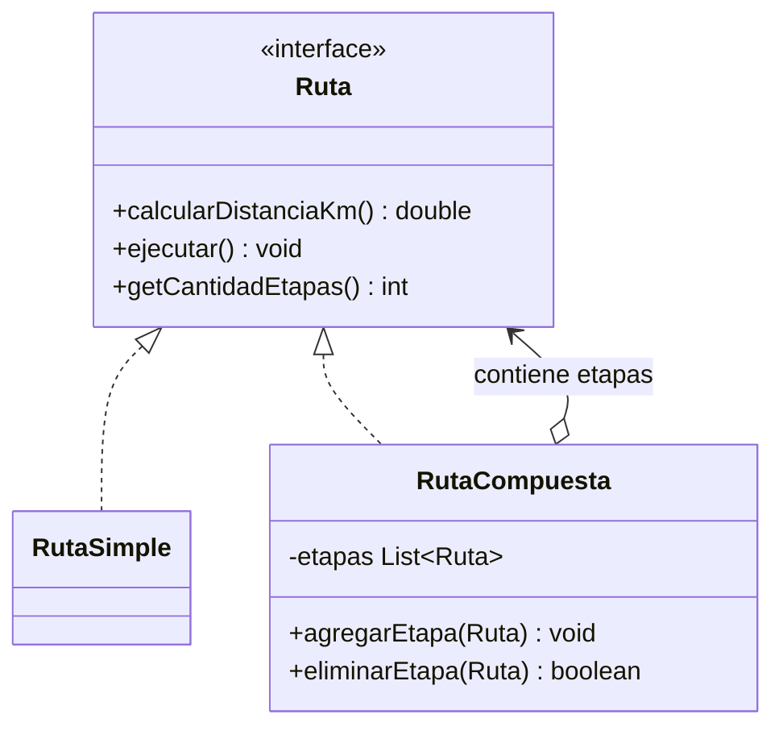
**Justificación:** permite tratar una ruta simple y una compuesta mediante la misma interfaz. Una solución con condicionales o clases para cada cantidad de etapas haría que el gestor tuviera que cambiar cuando cambie la estructura.

## 2. Strategy — optimización intercambiable
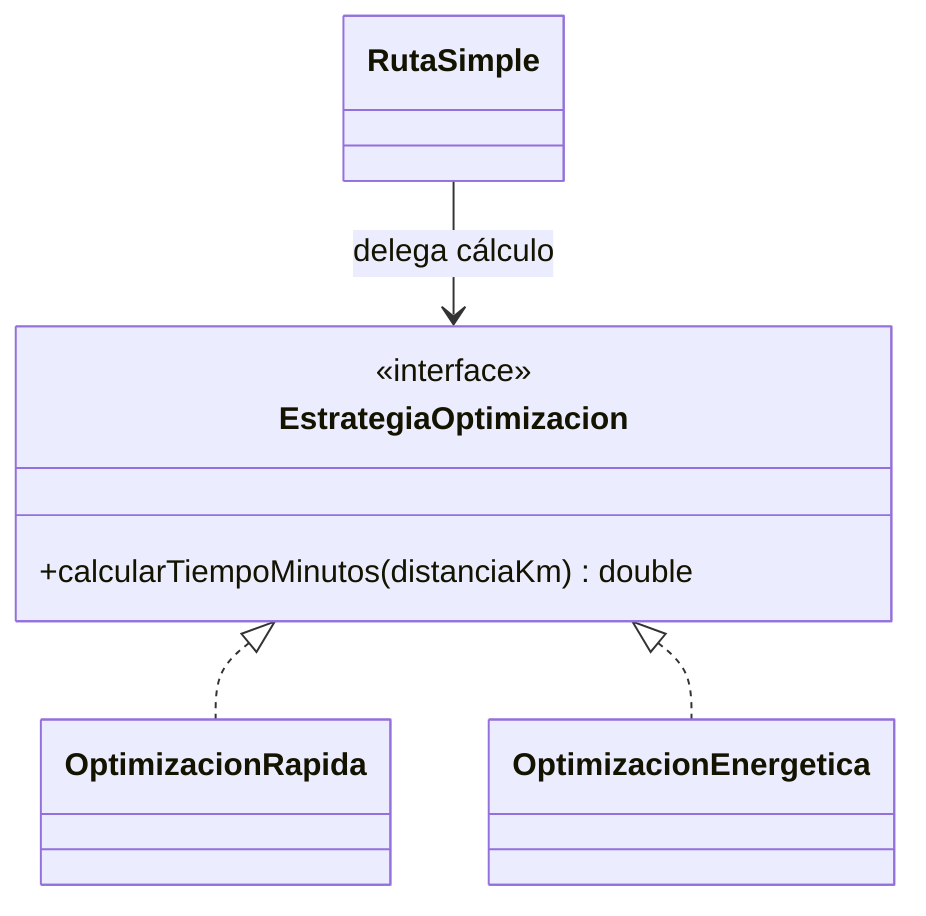
**Justificación:** cada algoritmo se encapsula detrás de una interfaz común. Es preferible a una cadena de `if/else` dentro de `RutaSimple`: se pueden agregar algoritmos sin modificar la clase existente, respetando el principio abierto/cerrado. En este ejemplo, rápida usa 60 km/h y energética 40 km/h.

## 3. Observer — alertas por etapa
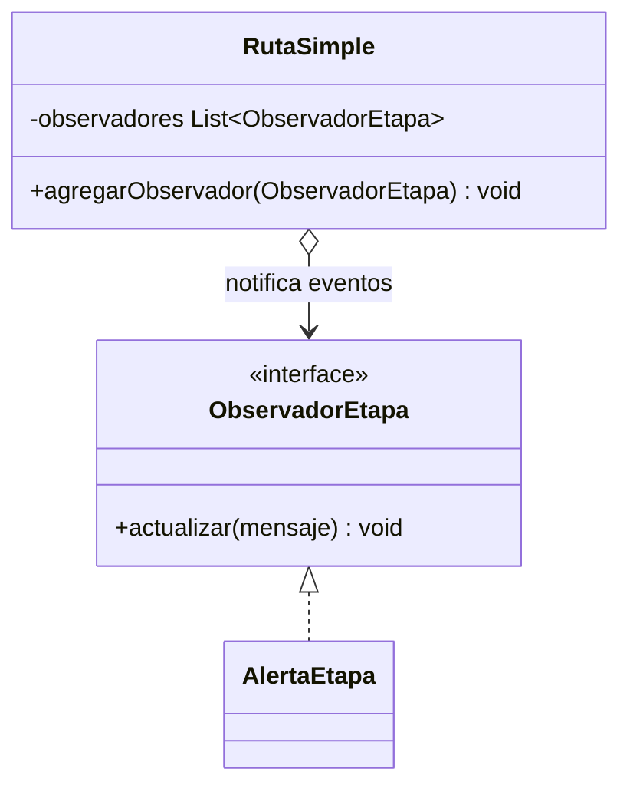
**Justificación:** separa la emisión de eventos de las acciones que reaccionan. Se pueden añadir receptores de consola, logs o monitoreo sin cambiar la ruta. Imprimir las alertas directamente en toda la lógica acoplaría el dominio a un único canal.

## 4. Factory Method — creación del tipo de dron
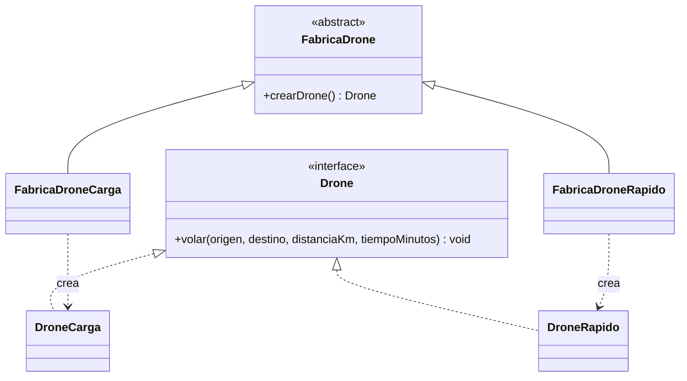
**Justificación:** la ruta solicita un `Drone` mediante una fábrica abstracta, sin instanciar directamente clases concretas. Nuevos tipos se agregan con nuevas fábricas, en vez de ampliar condicionales dentro de `RutaSimple`.

## Diagrama

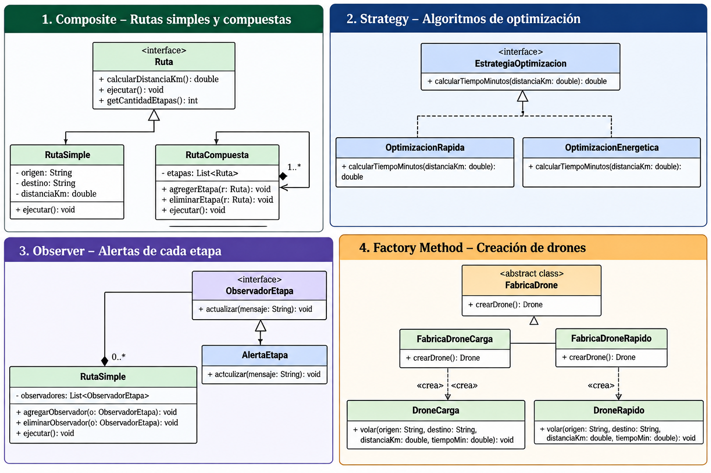

# Reto 4 — Asignador de Misiones Enterprise

## Evidencia

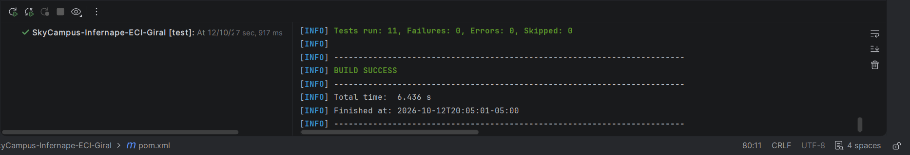

# Reto 5 — Evolución de los diagramas de contexto de SkyCampus

## 1. Introducción

Los diagramas de contexto de SkyCampus muestran cómo ha evolucionado el sistema desde su versión inicial MVP (Chimchar), pasando por la versión v2 (Monferno), hasta llegar a Enterprise (Infernape). En cada etapa se amplían los actores, las integraciones y las responsabilidades, de acuerdo con las necesidades de una plataforma cada vez más completa.

## 2. Comparación de los tres diagramas

### Chimchar — MVP

En la primera versión, SkyCampus App tiene una estructura sencilla y se centra en gestionar solicitudes y misiones de entrega con drones en el campus.

Los actores que interactúan con el sistema son:

- **Solicitante:** registra las solicitudes de entrega.
- **Operador:** gestiona las operaciones.
- **Admin:** administra el sistema.

En esta etapa no aparecen sistemas externos. Esto permite concentrarse en las funcionalidades principales antes de incorporar nuevas integraciones.

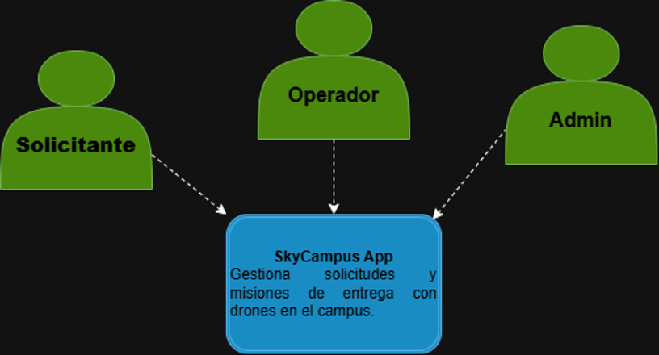

### Monferno — v2

En la segunda versión, SkyCampus conserva su propósito principal, pero amplía sus relaciones con el entorno. Aparecen integraciones con la API Meteorológica, el Control Aéreo ECI y el Sistema de Alertas.

También se amplía la representación de los actores administrativos y operativos. El diagrama muestra al Operador, Solicitante y Admin, con una segunda representación de Admin, además de las conexiones con los sistemas externos.

Esta evolución permite contemplar información meteorológica, coordinación aérea y notificaciones, haciendo que el sistema dependa de más componentes externos que en el MVP.

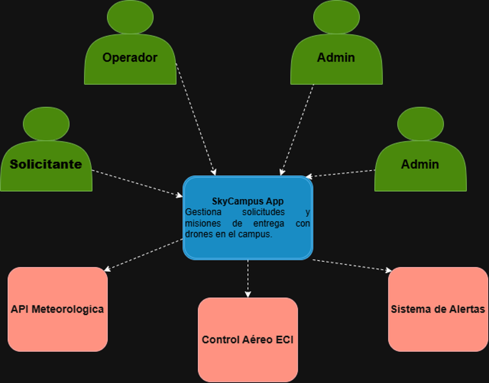

### Infernape — Enterprise

En la versión Enterprise, SkyCampus incorpora nuevos roles y amplía sus integraciones institucionales.

A los actores anteriores se suman:

- **Superadmin:** representa la supervisión general de la plataforma.
- **Coordinador de sede:** representa la coordinación de las operaciones en una sede.
- **Técnico de Mantenimiento:** representa las actividades de mantenimiento de los drones.

En cuanto a los sistemas externos, el diagrama incluye Aerocivil, ERP Universitario, Control Aéreo ECI, API Meteorológica y Sistema de Alertas. Esto refleja un entorno más amplio, con necesidades de coordinación institucional, operación y mantenimiento.

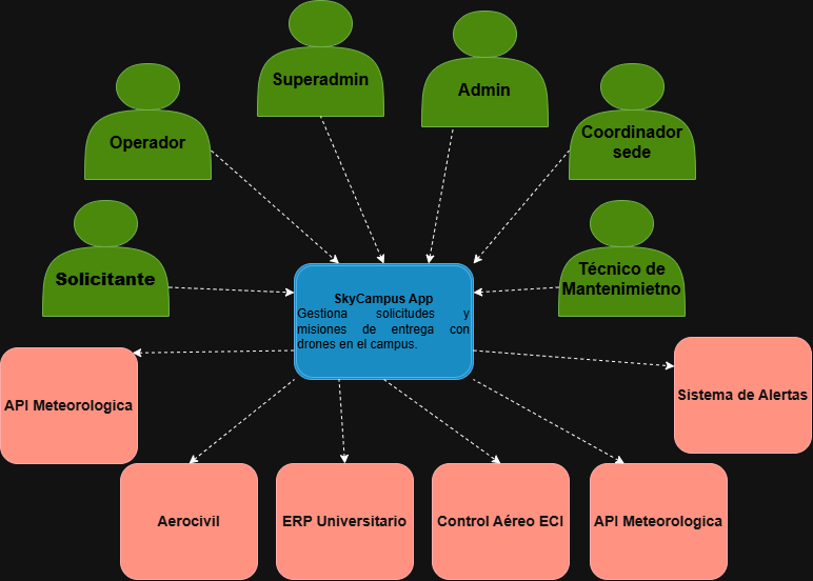

## 3. ¿Qué creció?

El crecimiento se observa principalmente en tres aspectos:

1. **Actores y responsabilidades:** aparecen roles relacionados con la supervisión empresarial, la coordinación de sedes y el mantenimiento de los drones.
2. **Integraciones externas:** se pasa de no tener sistemas externos en el MVP a depender de servicios meteorológicos, control aéreo, alertas e integraciones institucionales en las versiones posteriores.
3. **Complejidad operativa:** SkyCampus debe coordinar más responsabilidades y relaciones, lo que exige una mejor organización de sus funcionalidades y de la comunicación con otros sistemas.

## 4. ¿Qué se mantuvo?

A pesar de los cambios, el propósito central de SkyCampus sigue siendo el mismo: gestionar solicitudes y misiones de entrega con drones en el campus.

También se mantienen los actores fundamentales de la primera versión: Solicitante, Operador y Admin. Estos siguen siendo importantes incluso cuando se agregan nuevas responsabilidades y sistemas externos.

La aplicación continúa representando el punto central de interacción entre los usuarios y las funcionalidades del sistema. Las nuevas capacidades amplían su alcance, pero no reemplazan su objetivo inicial.

## 5. ¿Cómo evolucionó la complejidad sin perder la coherencia?

La complejidad aumentó de manera progresiva. Chimchar comienza con una aplicación sencilla y sin integraciones externas. Monferno incorpora servicios que apoyan la operación, como la información meteorológica, el control aéreo y las alertas. Finalmente, Infernape amplía los perfiles de usuario y las integraciones institucionales.

La coherencia se conserva porque las nuevas capacidades siguen relacionadas con el objetivo original de SkyCampus. No se cambia el propósito del sistema; se agregan responsabilidades y colaboraciones que permiten responder a necesidades más amplias.

Esta evolución también demuestra la importancia de definir claramente las responsabilidades de cada actor y de cada sistema externo. A medida que aumenta la complejidad, resulta necesario organizar mejor las relaciones para facilitar el mantenimiento, la comprensión y la futura ampliación de la plataforma.

## 6. Conclusión

La comparación de los tres diagramas muestra que SkyCampus pasó de una solución básica centrada en las solicitudes de entrega a una plataforma con más roles y relaciones institucionales.

Lo que más creció fue el número de responsabilidades y de integraciones externas, mientras que se mantuvo el objetivo principal de gestionar las operaciones de reparto con drones. La evolución progresiva permitió ampliar el sistema sin perder su identidad ni su propósito.

